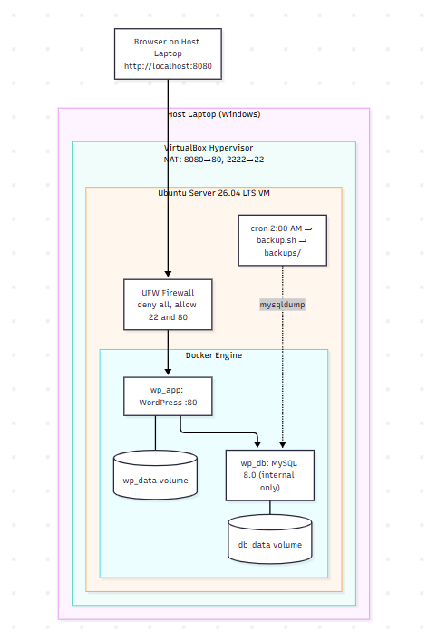
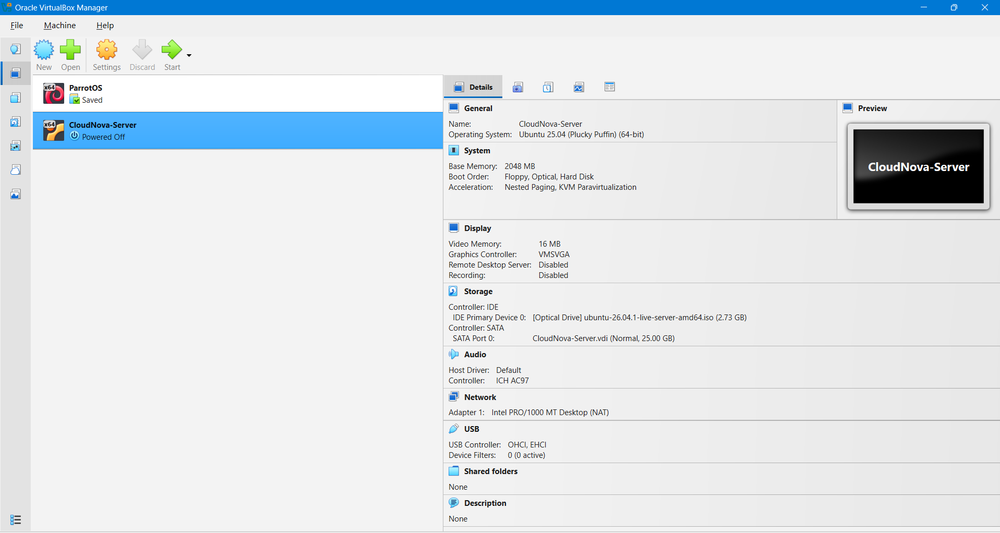
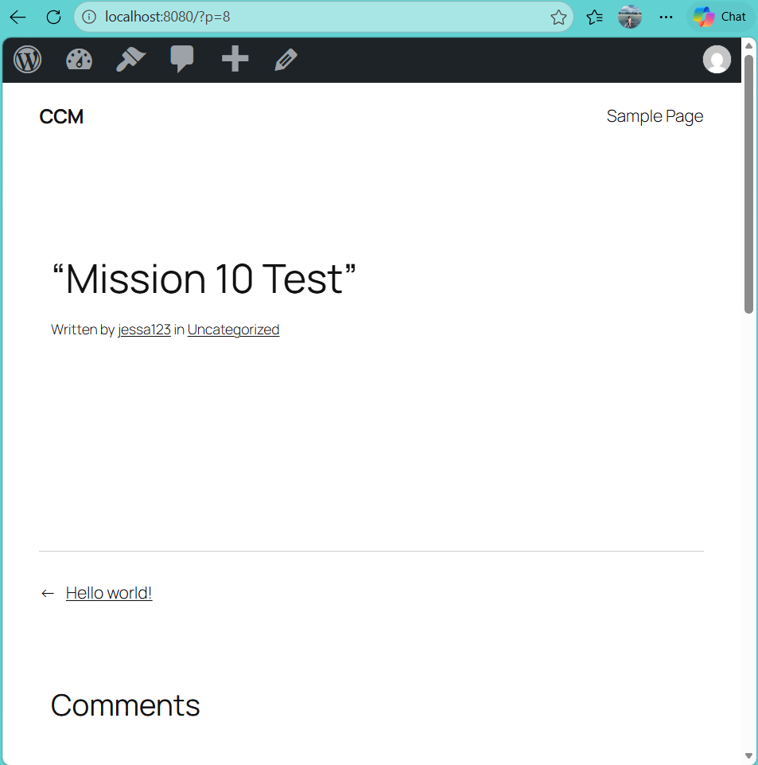
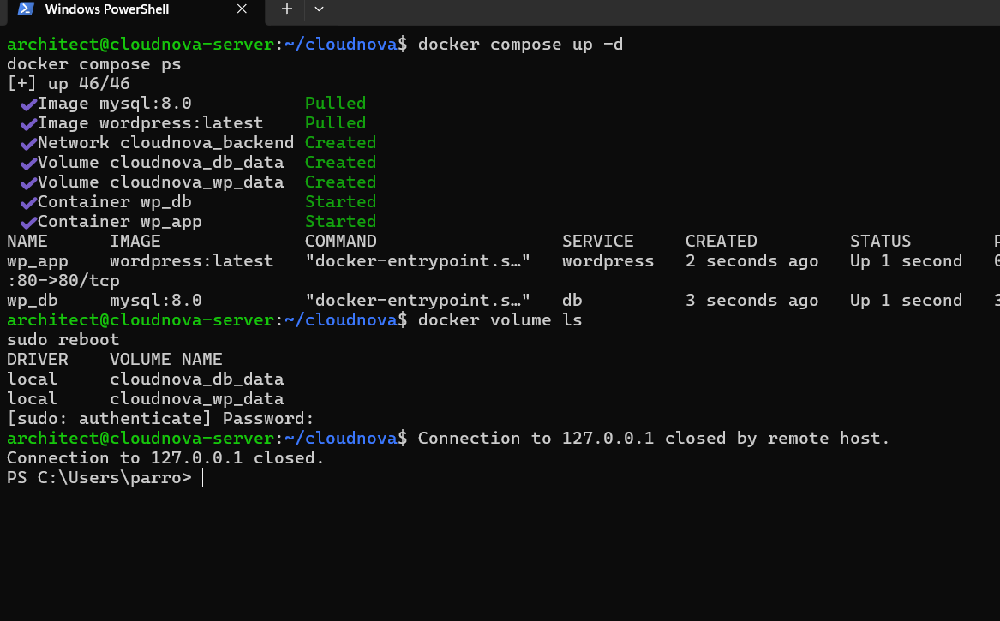
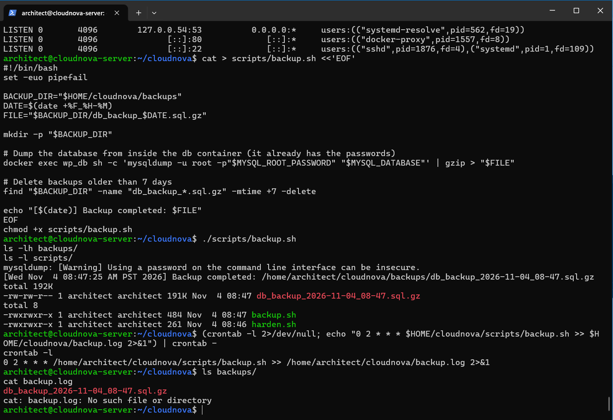
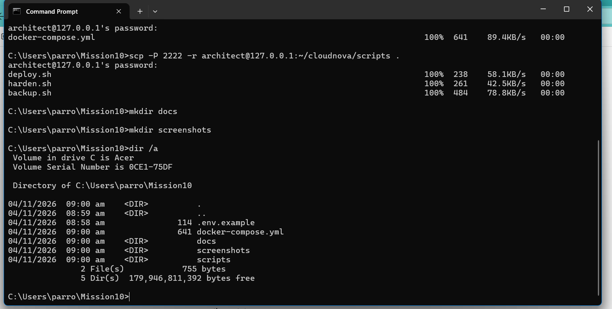

# Mission 10: Enterprise Cloud Architect
**Stack:** WordPress + MySQL 8.0 on Docker Compose, Ubuntu Server 26.04 LTS VM (VirtualBox)

## 1. Architecture


See also [docs/architecture.md](docs/architecture.md)

## 2. Prerequisites
VirtualBox, Ubuntu Server ISO, 2 GB RAM and 25 GB disk for the VM.

## 3. VM Setup
- 2 vCPU, 2 GB RAM, 25 GB disk, NAT networking
- Port forwarding: host 2222 → guest 22 (SSH), host 8080 → guest 80 (HTTP)
- Ubuntu Server installed with OpenSSH
- Timezone set with `sudo timedatectl set-timezone <Region/City>`

## 4. Deployment
```bash
git clone <repo-url> && cd Mission10
cp .env.example .env     # then edit the passwords
docker compose up -d
```
Open http://localhost:8080 and complete the WordPress installer.
Or run everything with one command: `bash scripts/deploy.sh`

## 5. Persistence
Named volumes `db_data` (database) and `wp_data` (site files).
Verified by rebooting the VM: containers restarted automatically and the published post remained.

## 6. Security
- UFW: default deny incoming, allow outgoing
- Allowed: 22/tcp (SSH), 80/tcp (HTTP) only
- Database port is not published; reachable only on Docker's internal network
- Secrets kept in `.env` (excluded from Git)

Apply with: `bash scripts/harden.sh`

## 7. Automation
`scripts/backup.sh` dumps the database, compresses it, and deletes backups older than 7 days.
Schedule (cron): `0 2 * * *` (daily at 2:00 AM). Log: `backup.log`.

## 8. Maintenance
| Task | Command |
|---|---|
| Status | `docker compose ps` |
| Logs | `docker compose logs -f` |
| Update images | `docker compose pull && docker compose up -d` |
| Manual backup | `./scripts/backup.sh` |
| Firewall status | `sudo ufw status verbose` |
| Cron jobs | `crontab -l` |

**Restore a backup:**
```bash
gunzip < backups/FILE.sql.gz | docker exec -i wp_db sh -c 'mysql -u root -p"$MYSQL_ROOT_PASSWORD" "$MYSQL_DATABASE"'
```

## 9. Evidence
**Port forwarding**



**Containers running**


**WordPress site with test post (before reboot)**



**Containers and site after reboot (persistence)**



**Docker volumes**


**Firewall, open ports, scripts, backup, and cron**



**Cron running automatically**



## 10. Reflection
See [docs/reflection.md](docs/reflection.md)
